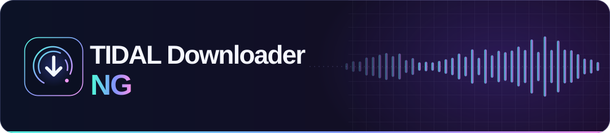

<div align="center">
  

  <p>Download TIDAL tracks, albums, playlists, and videos from the desktop app or CLI.</p>

  <p>
    <a href="https://github.com/librerob/tidal-dl-ng-1/releases/download/0.24.6-preview.1/tidal-dl-ng-windows-x64.zip"></a>
    <a href="#downloads"></a>
    <a href="https://github.com/librerob/tidal-dl-ng-1/releases/tag/0.24.6-preview.1"></a>
  </p>

  <p><a href="#downloads">All downloads</a> · <a href="#features">Features</a> · <a href="#install-from-source">Source install</a> · <a href="#recovery-and-settings">Recovery and settings</a></p>

  
</div>

A paid TIDAL plan is required. Available audio quality depends on the track and your account.

## Downloads

| Platform | Package | Launch |
| --- | --- | --- |
| Windows x64 | [ZIP](https://github.com/librerob/tidal-dl-ng-1/releases/download/0.24.6-preview.1/tidal-dl-ng-windows-x64.zip) | Extract the full archive and open `TIDAL Downloader.exe`. |
| macOS Apple Silicon | [ZIP](https://github.com/librerob/tidal-dl-ng-1/releases/download/0.24.6-preview.1/tidal-dl-ng-macos-arm64.zip) | Extract the ZIP, then open `TIDAL Downloader NG.app`. |
| macOS Intel | [ZIP](https://github.com/librerob/tidal-dl-ng-1/releases/download/0.24.6-preview.1/tidal-dl-ng-macos-x64.zip) | Extract the ZIP, then open `TIDAL Downloader NG.app`. |
| Linux x86-64 | [AppImage](https://github.com/librerob/tidal-dl-ng-1/releases/download/0.24.6-preview.1/tidal-dl-ng-linux-x64.AppImage) | Make the AppImage executable and run it. |

Python and Qt are bundled. SHA-256 checksums are on the [release page](https://github.com/librerob/tidal-dl-ng-1/releases/tag/0.24.6-preview.1). The Windows preview is unsigned and the macOS preview is not notarized.

For Linux, open a terminal in the download folder and run:

```sh
chmod +x tidal-dl-ng-linux-x64.AppImage
./tidal-dl-ng-linux-x64.AppImage
```

If FUSE is unavailable, use `./tidal-dl-ng-linux-x64.AppImage --appimage-extract-and-run`.

FFmpeg is optional. Install it separately for video conversion or FLAC extraction, then set `path_binary_ffmpeg` in Settings to the full path to the FFmpeg executable.

## Features

| Feature | What you can do |
| --- | --- |
| **Media and quality** | Download tracks, albums, playlists, mixes, videos, and favorites. Choose the audio or video quality. |
| **Library organization** | Save tags, lyrics, and cover art where available. Choose filename templates, generate M3U8 playlists in source order, and optionally link shared tracks across playlists. |
| **Queue recovery** | Wait and retry after a rate limit, or resume the same playlist from a local checkpoint. Existing non-empty files, including retagged files, are preserved. |
| **File checks** | Report failures, retry eligible standalone tracks, and check previously recorded files for changes. |
| **Login storage** | Save credentials in the system keyring when enabled. |

## Install from source

Clone this repository and use Python 3.12. On Windows, run the following in PowerShell.

```powershell
py -3.12 -m venv .venv
.\.venv\Scripts\Activate.ps1
python -m pip install ".[gui]"
tdng
```

On macOS or Linux, create the venv with `python3.12 -m venv .venv`, activate it with `source .venv/bin/activate`, then run the same pip install and launch commands.

For the CLI alone, install with `python -m pip install .`. To upgrade a source install, run `git pull` and repeat the install command in the same virtual environment.

### CLI examples

```powershell
tdn dl https://tidal.com/browse/track/46755209
tdn dl_fav tracks
tdn retry-failed
tdn verify-files
```

Run `tdn --help` for all commands.

## Recovery and settings

- **Rate limit (HTTP 429).** The app waits before retrying. If the queue pauses, resume in the GUI after the cooldown or rerun the CLI command with `skip_existing` enabled.
- **Playlist interrupted.** Reopen the same ordered playlist with the same output folder, filename template, and quality. The checkpoint preserves completed non-empty files and lets missing or empty files be downloaded again. If the database is unreadable, the app leaves it in place and continues with the normal download settings.
- **Failed or changed files.** Look for `failed_tracks.json` in the download folder. Use `tdn retry-failed` for eligible standalone tracks and reopen the original playlist for playlist failures. Use `tdn verify-files` to report missing files or changes in size or modification time.
- **Login storage.** Enable `use_keyring` with `tdn cfg use_keyring true`. For source installs, install the optional dependency with `python -m pip install ".[gui,keyring]"`. The app migrates an existing saved login on the next launch when the keyring is available.
- **Update checks.** Disable startup checks in GUI Settings or with `tdn cfg check_for_updates false`.

## Development

Install development dependencies with `poetry install --all-extras --with dev,docs`. The entry points are `tidal_dl_ng/cli.py` and `tidal_dl_ng/gui.py`. See the [Makefile](Makefile) for build targets and the [Windows workflow](.github/workflows/windows-portable.yml) and the [macOS and Linux workflow](.github/workflows/unix-preview.yml) for the clean-install and packaged launch checks.

Licensed under the [GNU AGPL v3](LICENSE).
