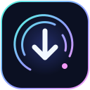

# TIDAL Downloader NG

The [librerob fork](https://github.com/librerob/tidal-dl-ng-1#readme) provides a desktop app and CLI for downloading tracks, albums, playlists, and videos from TIDAL.

- [Download the Windows preview](https://github.com/librerob/tidal-dl-ng-1/releases)
- [Install from source](https://github.com/librerob/tidal-dl-ng-1#install-from-source)
- [Playlist recovery and settings](https://github.com/librerob/tidal-dl-ng-1#recovery-and-settings)
